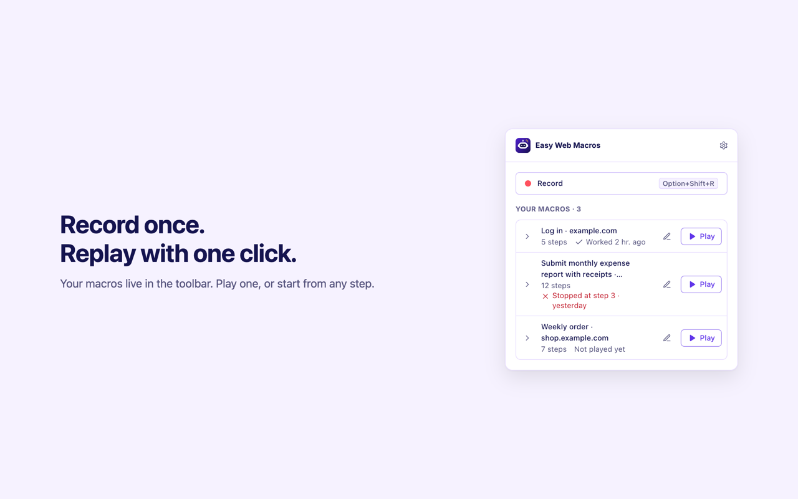

<p align="center">
  
</p>

<h1 align="center">Easy Web Macros</h1>

<p align="center">
  <b>Record once. Replay anytime.</b><br>
  <a href="https://github.com/epulla/easy-web-macros-v2/actions/workflows/build.yml"></a>
</p>

Meet Easy Web Macros, the little robot that does your repetitive web chores. Press Record,
do the task once, and press Stop. Next time, press Play and it clicks, types and chooses
for you, step by step, while you watch.

<p align="center">
  <a href="https://chromewebstore.google.com/detail/cmpjcbhhaneoeekleibpfoejfieblekk"></a><br>
  <sub>Chrome · <a href="#install">install steps</a> · <a href="https://github.com/epulla/easy-web-macros-v2/releases">all releases</a></sub>
</p>

<p align="center">
  
</p>

## What Easy Web Macros does

Easy Web Macros is a Chrome extension that records what you do on a website and plays it
back with one click.

- **Records what you do:** clicks, typing, choices from lists, tick boxes, keys, scrolling,
  pages you open and new tabs.
- **Plays it back reliably:** finds the right button or field even when the page changes a
  little, and waits for it to be ready.
- **Shows every step** while it plays, and explains in plain words when one gets stuck.
- **Lets you fix things:** try again, skip the step, or point at the right thing on the page.
- **Never saves passwords:** it asks you to type them when a macro reaches one.
- **Has an editor** to rename macros and reorder, fix, duplicate or delete steps.
- **Shares macros** as files you can save and add back.

<p align="center">
  
</p>

## Install

Install [Easy Web Macros from the Chrome Web Store](https://chromewebstore.google.com/detail/cmpjcbhhaneoeekleibpfoejfieblekk),
pin it from the extensions menu (the puzzle piece), and press Record.

Coming from the old version (0.0.x)? Your saved macros move over automatically the first
time the new version starts, and a "What's new" page opens.

### Build from source

You'll need Git, Node.js, and pnpm (the version used by this project is pinned in `package.json`).

```sh
git clone https://github.com/epulla/easy-web-macros-v2.git
cd easy-web-macros-v2
pnpm i
```

For testing, load the build as an unpacked extension:

1. Run `pnpm build`.
2. Open `chrome://extensions` and enable **Developer mode**.
3. Choose **Load unpacked** and select this project's `.output/chrome-mv3` folder.
4. The welcome page opens. Pin the extension and press Record.

Tabs that were already open need a reload before you can record in them.

## 🎬 Recording

Press **Record** in the popup, or **Alt+Shift+R** (Option+Shift+R on Mac). A small
"● Recording" label shows on the page and the toolbar icon shows **REC**.

| You do | Saved as |
| --- | --- |
| Click or double-click | Click / Double-click "Sign in" |
| Type in a field | Type in "Email" (one step per field, final value) |
| Type in a password field | Type password in "Password" (**no value saved**) |
| Pick from a list, tick a box, choose an option | Choose / Check / Pick |
| Press Enter, Tab, Escape or a shortcut like Ctrl+S | Press … |
| Scroll | Scroll to … (once scrolling stops) |
| Choose a file | Upload a file to … (a placeholder; no file is saved) |
| Open a page or a link in a new tab | Go to … / Open … in a new tab |
| Rest the pointer on something (optional, in ⚙️ Settings) | Hover over … |

Duplicates are cleaned up as you go: clicks on fields and labels are covered by the
typing or choice step, two clicks plus a double-click become one double-click, and so on.
Recording works inside same-site frames and web components.

Press **Stop and save**. The macro is named after the page you started on, like
"Log in · example.com".

## ▶️ Playing

Press **Play** on a macro. Each step shows as waiting, playing, done, failed or skipped,
and the toolbar icon shows **▶** (or **!** if a step gets stuck).

### Finding the right element

Each step remembers several ways to find its target, best first: test ids and stable
`data-*` attributes, the element id, its role and name, its label, placeholder or field
name, and its visible text. A CSS path and XPath are kept only as a last resort.

On replay it tries them in order, needs exactly one match, and waits up to **10 seconds**
for it to be visible and enabled. When several identical widgets sit on the page, the
step also remembers which widget it belongs to.

### When a step gets stuck

The run stops with a plain message, like *Step 4: couldn't find the **Submit** button on
this page.*, and offers:

- **Try again**, for pages that were still loading.
- **Pick it on the page**: click the right element; the macro keeps the fix.
- **Skip this step** and carry on.

Password steps ask you to type the password (used once, never saved). File steps ask you
to choose the file on the page.

### Speed and start point

In ⚙️ Settings choose **Slow**, **Normal**, **Fast** or **Fastest**. Open a macro's steps
to **Play from here** on any step. Pause, Continue and Stop work at any time.

## ✏️ Editing

The pencil opens the editor in a tab:

- Rename a macro, set the **wait between steps** (default 1 second), how many **times to
  play**, or **keep repeating** until you press Stop.
- Reorder steps by dragging or with the ↑ ↓ buttons.
- **Edit** a step's name, value and the ways it's found; **Duplicate** or **Delete** it
  from the ⋯ menu.
- **Save to a file** and **Add from a file** (also accepts old `.em.json` exports).

Every change saves on its own, and the editor stays in sync with recordings and fixes
made elsewhere.

## Known limits

- Identical unlabelled items that swap places (for example, two unnamed icon buttons) can
  make replay use the wrong one. Use **Pick it on the page** or record on a label instead.
- A password field with no label, inside a web component that loads late, revealed with
  "show password" before you type, may be saved as plain text. Edit or delete that step.
- Editing the same field in two editor tabs at once: the later change wins.
- Single-page apps that change the address without loading a new page don't get a
  "Go to" step. Start the macro on the right page.
- Tabs open before installing or updating need a reload before recording.
- Chrome pages, the Chrome Web Store and other extensions' pages can't be recorded.

## 🛠️ Development

Built with WXT 0.21, React 19, TypeScript, Tailwind CSS v4, and Vitest. Use pnpm for all
commands; see [AGENTS.md](AGENTS.md) for project conventions.

| Task | Command |
| --- | --- |
| Install dependencies | `pnpm i` |
| Start development | `pnpm dev` |
| Type-check | `pnpm compile` |
| Run tests | `pnpm test` |
| Build | `pnpm build` |
| Package for store submission | `pnpm zip` |

Before submitting changes, run:

```sh
pnpm compile && pnpm test
```

Builds and ZIP packages are written to `.output/`. Store listing text, privacy answers and
screenshots live in [docs/store/](docs/store/); brand assets in [docs/brand/](docs/brand/).

## Privacy

Your macros stay in your browser, on your computer. Nothing is sent anywhere. See
[PRIVACY.md](PRIVACY.md).

## License

[MIT](LICENSE)
